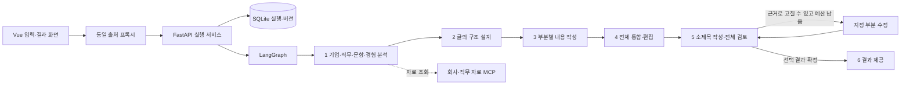
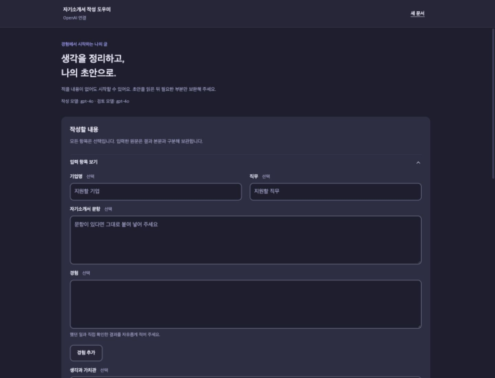
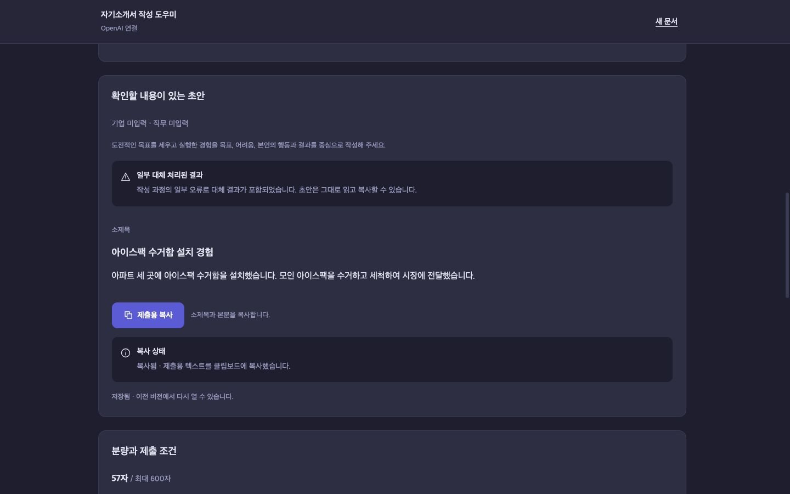

# 자기소개서 초안 작성 서비스 Essay Agent

기업·직무·문항과 지원자의 경험을 입력하면 **소제목+본문 초안+실제 문장에 맞춘 구조 설명+부분별 보완 제안**을 제안하는 로컬 웹 서비스입니다.

## 1. 주제 선정 배경
2가지 아이디어에서 착안했습니다.
1. 자소서를 잘 쓰는 방법에 대한 정보는 충분히 많으며 핵심은 비슷하다.
>> 국가기관, 학술논문, 저서 등 많은 곳에서 정보를 얻을 수 있습니다. 또한 '간결하게 작성', '핵심메세지를 전달', '두괄식'처럼 작성하고자 하는 자기소개서에서 누구에게 무엇을 어떻게 보여줄 것인가?에 대한 핵심 내용은 비슷합니다. 
2. 글을 쓰는 방법(방법론)이 같더라도 작성자에 따라 글의 스타일은 완전히 달라질 수 있다.
>> 자기소개서 작성을 통해 본인을 드러내기 위해 방법론이 달라야하는 것은 아닙니다. 개개인이 겪었던 경험은 전부 다르기 때문에 정해진 구조에 맞게 잘 녹여내기만 한다면, 자기소개서에서 본인을 잘 드러낼 수 있을 것입니다.

## 2. 해결하고자 하는 문제

자기소개서에서 가장 중요한 것은 자신의 경험과 강점을 바탕으로 ‘나는 어떤 사람인지’를 효과적으로 전달하는 것입니다. 하지만 많은 지원자는 문장을 어떻게 시작할지, 어떤 형식과 표현을 써야 할지에 많은 시간과 에너지를 쏟습니다. 글을 매끄럽게 다듬는 데 집중하다 보면 정작 자신을 어떻게 표현할지 충분히 고민하지 못하게 됩니다.

## 3. 개발 환경 및 기술 스택

| 구성 | 사용 기술과 역할 |
| --- | --- |
| 실행 환경 | Python 3.11, [uv](https://docs.astral.sh/uv/), `requirements.txt`의 고정 버전 |
| API·실행 | FastAPI, LangGraph `StateGraph`, Pydantic v2 |
| 모델 | LangChain `ChatOpenAI`와 OpenAI API, 비동기 Structured Outputs |
| 자료·저장 | FastMCP/stdio, SQLite |
| 화면 | Vue 3 CDN, 동일 출처 FastAPI 프록시, 별도 프런트엔드 빌드 없음 |

FAST 역할은 분석·구조 설계, QUALITY 역할은 부분 작성·통합·검토·수정을 맡습니다. 기본 모델은 두 역할 모두 `gpt-4o`이며 `OPENAI_FAST_MODEL`과 `OPENAI_QUALITY_MODEL`로 각각 바꿀 수 있습니다. 두 모델 모두 Structured Outputs를 지원해야 합니다. 실행 중인 한 요청의 기술/형식 재시도는 논리 호출당 최초 시도 포함 최대 2회입니다. 모델 연결은 [`agent/openai_llm.py`](agent/openai_llm.py), 설정은 [`agent/app_runtime.py`](agent/app_runtime.py)에 있습니다.

## 4. 시스템 아키텍처



사용자가 입력한 정보를 바탕으로 자소서 초안을 단계적으로 만들고, 근거가 부족하거나 수정이 필요한 부분을 제한적으로 보완하는 파이프라인형 에이전트입니다.

## 5. 주요 구현 기능

1. **원문 분석:** 기업 자료·채용 공고와 지원자 경험을 구분하고, 문항 요구·답 소재·사용 가능한 근거·공백을 연결합니다. 회사 설명으로 지원자의 개인 동기를 만들지 않습니다.
2. **구조 설계와 작성:** 선택한 경험, 문단 역할·순서·분량을 정한 뒤 부분별 문장을 쓰고 하나의 초안으로 연결합니다. STAR나 두괄식은 글을 구성하는 방법이며 없는 사실을 생성하는 허가가 아닙니다.
3. **소제목·검토:** 제목과 본문을 현재 원문·문항·글자 수 조건에 대조합니다. 근거로 고칠 수 있는 부분만 최대 2회 수정하고, 부족한 정보는 보완 제안으로 돌립니다.
4. **결과 제공:** 소제목·본문·제출용 복사문, 실제 문장 위치를 보여 주는 구조, 필수/선택 제안을 제공합니다. 제목이 금지되면 참고 소제목은 화면에만 보이고 복사문에서는 제외됩니다.
5. **새 버전과 복구:** 원문을 추가·정정한 뒤 새 버전을 만들고 이전 결과도 조회합니다. 스트림이 끊겨도 저장 결과를 조회할 수 있고, 저장 실패는 생성 결과와 따로 표시합니다.

자세한 계약은 [API·저장·수정 안내](doc/README.md)에 있습니다.

## 6. 프로그램 실행 방법과 시험 입력

프로젝트 폴더에서 Python 3.11과 `uv`를 준비합니다. 실제 OpenAI 모델을 쓰려면 Git에 포함되지 않는 `.env`에 본인 키를 설정합니다. `.env.example`은 변수 이름의 예시입니다.

```bash
bash sh/setup_venv.sh
# .env에 OPENAI_API_KEY=본인키 설정
bash sh/run_agent_openai.sh
# 다른 터미널에서 같은 폴더로 이동
bash sh/run_frontend.sh
```

브라우저에서 **[http://127.0.0.1:8600](http://127.0.0.1:8600)** 을 엽니다. 백엔드는 `127.0.0.1:8100`입니다. 실행만으로 모델을 호출하지 않으며, **초안 작성**을 누르면 실제 API 요청이 발생합니다. 키가 없는 구조·화면 테스트는 `LLM_BACKEND=fake LANGCHAIN_TRACING_V2=false .venv/bin/python server.py`로 실행할 수 있지만, fake 출력은 글의 품질을 평가하는 자료가 아닙니다. 실행기는 기존 DB를 지우거나 다른 프로세스의 포트를 강제로 비우지 않습니다.

다음 값은 **실존 기업이나 사용자의 경험이 아닌 가상 데이터**입니다. 화면의 같은 이름 입력란에 붙여 넣고, 공백·줄바꿈 포함을 켠 상태에서 초안 작성을 누르세요.

기업명: 모아데이터

직무:서비스 기획

자기소개서 문항: 협업 중 발생한 문제를 해결한 경험을 본인의 역할, 행동, 결과와 배움을 중심으로 작성해 주세요.

경험: 대학 팀 프로젝트에서 지역 상권 이용자를 위한 서비스 개선안을 준비하며 설문 자료 취합을 담당했습니다. 팀원 네 명이 각자 조사한 응답을 공유했는데, 항목 이름과 날짜 표기 방식이 달라 같은 질문의 답변이 서로 다른 열에 들어갔습니다. 저는 원본을 바로 합치면 누락 여부를 확인하기 어렵다고 판단해 공통 양식 초안을 만들었습니다. 양식에는 질문별 항목 이름, 응답일, 원문을 확인할 수 있는 칸을 두고 팀원들에게 사용해 보며 불편한 점을 알려 달라고 요청했습니다. 한 팀원이 자유 응답을 한 칸에 넣으면 맥락이 끊긴다고 말해 원문을 별도 칸에 남기는 방식으로 바꿨습니다. 이후 팀원들이 수정한 양식에 각자 자료를 옮겼고, 저는 중복 항목과 빈칸을 확인해 다시 질문했습니다. 기준이 같아진 뒤에는 자료를 하나의 표로 합쳐 기한 내 정리본을 제출했습니다.

생각과 가치관: 이 경험을 통해 협업에서 각자의 성실함만큼 자료를 다루는 기준을 먼저 맞추는 일이 중요하다는 점을 배웠습니다. 이후 협업에서는 항목 이름과 결과물 형식을 합의하고, 중간 점검 시간을 정하려고 합니다. 의견이 다르면 누가 맞는지부터 가리기보다 실제 작성 사례를 함께 보며 기준을 고치고 다시 공유합니다. 공통 양식에 맞추되 중요한 맥락을 위해 원문과 수정 이유를 남깁니다.

최대 글자 수: 600

기업 자료·채용 공고: 공란


## 7. 테스트 결과 및 실행 화면

| 검증 | 실행 결과 |
| --- | --- |
| Python 전체 회귀 | 504개 통과, 실패·오류·건너뜀 0 (최종 핵심 구현 후보) |
| 마지막 프롬프트·모델 기본값 변경 | 관련 검사 34개 통과, 관련 없는 검사 19개 제외; 위 전체 검사와 합산하지 않음 |
| Node 화면 모듈·스트림 파서 | 14개 통과 |
| 실제 프로세스 통합 | FastAPI·프록시·stdio MCP·SQLite·재시작의 32개 시나리오 통과 |
| 실제 OpenAI + Computer Use | 빈 입력의 일반 초안, 짧은 협업 경험, 원문 보완, 아이스팩 입력의 근거 유지, 복사·저장·새로고침·모바일 표시 확인 |

검증 중 빈 입력은 개인 경험을 꾸미지 않은 일반 본문과 보완 제안을 제공했습니다. 아이스팩 시험의 최종 본문은 제공한 두 문장 57자만 유지하고, 주어지지 않은 목표·어려움은 제안으로 분리했습니다. 형식 오류로 대체 경로가 작동한 결과와 반복 문장이 있는 결과도 관찰했으므로 **모든 입력에서 좋은 문장이 나온다는 증거는 아닙니다.** [브라우저 검증 기록](doc/verification/COVER-14-browser.md)과 [근거 일치 검증](doc/verification/COVER-15-fidelity.md)에 성공과 한계를 함께 적었습니다.





로컬에서 재검사할 때는 `.venv/bin/python -m pytest tests -q`와 `node --test tests/test_web_modules.mjs`를 실행합니다. 결과 화면은 가상 시험 데이터를 사용한 실제 OpenAI 실행이며, 개인 키·실행 DB·원시 모델 추적 기록은 저장소에 올리지 않습니다.

## 8. 단일 모델 요청과 에이전트 비교

2026-10-22(KST)에 **6번의 동일한 가상 입력**으로 직접 `gpt-4o` 호출 3회와 서비스의 새 문서 작성 3회를 실행했습니다. 직접 호출은 아래 프롬프트를 단일 사용자 메시지로 한 번씩 보냈고, 서비스는 기업명·직무·문항·경험·생각과 가치관을 같은 값으로 채웠습니다. 양쪽 모두 추가 수정 요청 없이 첫 결과를 평가했습니다. 서비스는 기본 문체(담백한 존댓말), 공백·줄바꿈 포함, 소제목 글자 수 제외를 사용했습니다. 기업 자료와 채용 공고는 양쪽 모두 비웠습니다.

```text
다음 정보를 바탕으로 600자 이내 자기소개서를 작성해줘.
기업명: 모아데이터 (가상)
직무: 서비스 기획
문항: 협업 중 발생한 문제를 해결한 경험을 본인의 역할, 행동, 결과와 배움을 중심으로 작성해 주세요.
경험: 대학 팀 프로젝트에서 지역 상권 이용자를 위한 서비스 개선안을 준비하며 설문 자료 취합을 담당했습니다. 팀원 네 명이 각자 조사한 응답을 공유했는데, 항목 이름과 날짜 표기 방식이 달라 같은 질문의 답변이 서로 다른 열에 들어갔습니다. 저는 원본을 바로 합치면 누락 여부를 확인하기 어렵다고 판단해 공통 양식 초안을 만들었습니다. 양식에는 질문별 항목 이름, 응답일, 원문을 확인할 수 있는 칸을 두고 팀원들에게 사용해 보며 불편한 점을 알려 달라고 요청했습니다. 한 팀원이 자유 응답을 한 칸에 넣으면 맥락이 끊긴다고 말해 원문을 별도 칸에 남기는 방식으로 바꿨습니다. 이후 팀원들이 수정한 양식에 각자 자료를 옮겼고, 저는 중복 항목과 빈칸을 확인해 다시 질문했습니다. 기준이 같아진 뒤에는 자료를 하나의 표로 합쳐 기한 내 정리본을 제출했습니다.
생각과 가치관: 이 경험을 통해 협업에서 각자의 성실함만큼 자료를 다루는 기준을 먼저 맞추는 일이 중요하다는 점을 배웠습니다. 이후 협업에서는 항목 이름과 결과물 형식을 합의하고, 중간 점검 시간을 정하려고 합니다. 의견이 다르면 누가 맞는지부터 가리기보다 실제 작성 사례를 함께 보며 기준을 고치고 다시 공유합니다. 공통 양식에 맞추되 중요한 맥락을 위해 원문과 수정 이유를 남깁니다.
```

평가는 본문에서 **역할·행동·결과·배움의 표현, 제공하지 않은 주장, 600자 준수, 문장 편집 상태**를 확인했습니다. 글자 수는 공백·줄바꿈을 포함한 실제 표시 텍스트 기준입니다. 서비스의 소제목은 설정대로 분량에서 제외했습니다.

| 실행 | 본문 글자 수 | 네 요구 | 600자 | 실제 결과에서 보인 특징 |
| --- | ---: | --- | --- | --- |
| 직접 요청 1 | 668 | 모두 표현 | 초과 | `[본인 이름]` 자리표시자를 남기고, 원문에 없는 `누락 없이`라는 결과를 덧붙임 |
| 직접 요청 2 | 664 | 모두 표현 | 초과 | `[당신의 이름]` 자리표시자와 인사·끝인사가 들어감 |
| 직접 요청 3 | 650 | 모두 표현 | 초과 | 이름 자리표시자는 없으나 배움을 `협업의 성패를 좌우`로 강하게 표현함 |
| 서비스 1 | 213 | 모두 표현 | 충족 | 단계 오류 후 대체 초안. 피드백을 받아 양식을 고친 핵심 행동이 빠져 지나치게 짧음 |
| 서비스 2 | 482 | 모두 표현 | 충족 | 단계 오류 후 대체 초안. 입력 경험을 거의 그대로 이어 붙이고 소제목도 포괄적임 |
| 서비스 3 | 347 | 모두 표현 | 충족 | 정상 완료. 문제→행동→결과→배움이 문단별로 드러나지만 `정리 본`처럼 어색한 표현이 남음 |


[6회 출력 전문과 실행별 관찰](doc/verification/README-8-comparison.md)을 함께 공개합니다. 이는 동일한 소재의 소규모 수동 비교이며, 직접 요청 프롬프트에는 별도의 소제목·구조 설명·문체 조건을 넣지 않았습니다. 따라서 출력 형식 차이는 설계 차이로 읽어야 하고, 세 번씩의 결과로 일반적인 승률이나 모델의 우열을 추정할 수 없습니다. 기존 장애 진단 앱과의 코드 수준 Before/After는 [재사용 지도](doc/reuse-map.md)에 있습니다.

## 9. 개발 과정에서의 문제점 및 해결 방법

| 관찰한 문제 | 적용한 해결 |
| --- | --- |
| 실제 모델의 원문 인용 위치·분량 값이 어긋나 짧은 경험도 대체문으로 빠짐 | 현재 원문에서 유일하게 정확히 일치하는 인용만 위치를 보정하고, 글자 수는 서버가 계산 |
| 행동에서 말하지 않은 배움이나 이웃 참여 효과를 추론 | 현재 지원자 원문의 생각·배움 근거 유형 검사와 작성·검토 지시를 강화; 최종 사례를 다시 대조 |
| 브라우저에서 사용자 정의 태그의 축약 표기를 HTML 파서가 삼켜 폼 일부가 사라짐 | 명시적인 닫는 태그로 수정하고 실제 브라우저/파서 검사 추가 |
| 부분 결과·수정 실패 때문에 유효 본문이 사라질 위험 | 현재 근거로 검증된 부분과 이전 안전한 선택본 보존; 실패도 수정 예산에 포함 |
| SSE 연결/저장 오류가 초안 생성 오류와 섞임 | 실행과 구독을 분리하고, 저장 상태·품질 상태·기술 오류를 별도 표시 |

## 10. 한계점 및 향후 개선 방향

• 한계점
직접 요청은 이 입력에서 세 번 모두 관련 내용을 비교적 풍부하게 풀어 썼지만 글자 수가 너무 적게 출력됩니다. 아직 에이전트가 작성한 초안은 직접 요청보다 글이 짧거나 원문 복사에 가까워, **문장 품질까지 서비스가 일관되게 우수하다는 가설은 이 결과로 확인되지 않았습니다.**

• 향후 개선 방향
실제 사용 가능한 수준으로 만들기 위해 프로그램의 코드가 수행해야할 업무의 범위와 AI가 수행해야할 업무의 범위를 명확히 구분하여 설계가 필요합니다.
