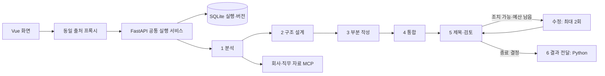

# essay-agent

## 1. 프로젝트명 및 주제 선정 배경

자기소개서 작성 에이전트. 사용자가 제공한 경험·관점·문항을 근거로 읽을 수 있는 초안을 만들고, 실제 표현된 구조와 보완할 내용을 함께 보여 준다. 기존 FastAPI·LangGraph·Vue 프로젝트의 실행 구조를 재사용했다.

## 2. 해결하고자 하는 문제

빈 입력이나 짧은 경험 때문에 작성을 중단하지 않으면서, 없는 성과·동기·배움·포부를 만들어 넣지 않는다. 개인 근거가 없으면 비개인 일반 초안을 제공하고 부족한 정보는 본문 밖에 표시한다. 이전 AI 문장은 편집 참고이며 새 개인 사실의 출처가 아니다.

## 3. 개발 환경 및 기술 스택

Python 3.11, FastAPI, LangGraph StateGraph, Pydantic v2, SQLite, FastMCP/stdio, Vue CDN을 사용한다. `requirements.txt`는 함께 검증한 버전을 고정한다. 실제 모델 호출은 `agent/openai_llm.py` → `ChatOpenAI`의 비동기 Structured Outputs 경로다. 빠른 모델은 분석·구조, 품질 모델은 작성·통합·검토·수정을 담당한다. 두 모델 모두 Structured Outputs 지원이 필요하다. 별도 프런트엔드 빌드 체계는 없다.

## 4. 시스템 아키텍처



여섯 논리 단계와 수정 노드 하나로 구성한다. 수정 횟수는 진입 시 증가하며 실패·제목만 수정도 포함한다. 0/1/2회 수정 시 노드 방문은 6/8/10회, recursion limit은 20이다. 논리 모델 호출별 기술 재시도는 최초 요청 포함 최대 2회이며 수정 예산과 별개다. 전달 단계는 모델을 호출하지 않는다. JSON과 POST SSE는 같은 실행 경로를 쓴다.

## 5. 주요 구현 기능

- 자료 원문·코드포인트 span·사실·요구·후보·구조의 참조를 검증한다. 필요성, 근거 상태, 적용 여부는 별개다. 회사 자료로 개인 동기를 대체하지 않는다.
- 최종 소제목, 본문, 실제 문장 위치를 가진 구조, 필수/선택 보완 제안을 반환한다. 계획했으나 쓰지 못한 부분도 표시한다.
- 제목 금지는 화면용 `display_only`로 표시하고 `copy_text`에서 제외한다. 고정 제목은 보존한다. 글자 수는 서버가 NFC/LF 계수 정책과 공백·줄바꿈·제목 포함 여부로 계산한다. 표시·복사 문자열 자체를 정규화하지 않는다.
- `generation_status`는 생성 결과, `review_status`와 `display_status`는 검토 범위, `persistence_status`는 저장 상태다. 검토 수행은 요구 충족 보증이 아니다. 실제 최대 길이가 불명확하면 미평가이며 초안은 제공한다.
- 선택적 질문은 `question_key`로 이어지고 확인 불가·해결·불필요 상태를 보존한다. 질문 답변 전 대기하는 단계는 없다.
- SQLite에 실행 식별자·정규화 입력·완료 버전을 보존한다. 재시작 시 소유 작업이 없는 running 실행은 interrupted로 처리하고 이전 완료 초안은 유지한다.

## 6. 프로그램 실행 방법

프로젝트 디렉터리에서 Python 3.11과 [uv](https://docs.astral.sh/uv/)를 준비한다.

```bash
bash sh/setup_venv.sh
# 실제 모델: .env.example을 참고하여 로컬 .env 또는 프로세스 환경에 키 설정
bash sh/run_agent_openai.sh
# 다른 터미널
bash sh/run_frontend.sh
```

화면은 `http://127.0.0.1:8600`, 백엔드는 `http://127.0.0.1:8100`이다. 실행만으로 모델 요청을 보내지 않는다. 실제 작성 요청은 API 비용이 발생할 수 있다. 환경 변수 우선순위는 프로세스 → 로컬 dotenv → 기본값이다. 기존 DB·환경·모델 설정을 지우지 않으며 바쁜 포트의 소유자를 종료하지 않는다. Ctrl+C/TERM은 해당 실행기가 생성한 자식 하나만 종료한다.

키 없는 결정적 테스트 실행:

```bash
LLM_BACKEND=fake LANGCHAIN_TRACING_V2=false .venv/bin/python server.py
# 다른 터미널에서 프록시
bash sh/run_frontend.sh
```

fake는 의미 품질을 평가하는 실제 모델이 아니다. 추적 키는 필수가 아니다. `ESSAY_LOAD_DOTENV=0`은 dotenv 읽기를 끈다. `ESSAY_DB_PATH`로 DB를 지정하고 `ESSAY_MCP_ENABLED=0`으로 MCP를 끌 수 있다. 유지된 실행기는 `AGENT_PORT`, `FRONTEND_PORT`, `AGENT_BASE_URL`의 loopback 주소를 지원한다. 직접 `python server.py`/`web_demo_server.py` 실행은 각각 8100/8600이다. 다른 포트는 다음처럼 실행한다.

```bash
AGENT_PORT=18100 LLM_BACKEND=fake bash sh/run_agent_openai.sh
AGENT_PORT=18100 FRONTEND_PORT=18600 bash sh/run_frontend.sh
```

`.env`에 `AGENT_BASE_URL`을 지정했다면 두 번째 명령에도 같은 백엔드 포트의 URL을 명시한다. [API·저장·수정 계약](doc/README.md)을 참고한다.

## 7. 테스트 결과 및 실행 화면

```bash
uv pip install --python .venv/bin/python -r requirements-dev.txt
.venv/bin/python -m pytest -q
bash -n sh/setup_venv.sh sh/run_agent_openai.sh sh/run_frontend.sh
.venv/bin/python -m pytest tests/test_launchers.py -q
```

계약 경계, 실제 stdio MCP, 실제 LangGraph 0/1/2회 수정, SQLite·JSON/SSE, UTF-8 스트림, 프록시, 실행기 테스트를 포함한다. fake HTTP smoke는 실제 서버와 프록시를 별도 포트에서 띄워 빈 요청의 저장된 초안을 확인한다. [수동 회귀 시나리오](doc/regression_test_queries.md)를 실제 브라우저에서도 확인한다. 실제 모델과 화면 품질은 별도의 통합 검증 대상으로, 단위 테스트 성공과 구분한다.

## 8. 기존 프로젝트를 개선한 경우 Before / After 비교

기존 운영 장애 분류·도구 반복·대화 화면을 자기소개서의 근거 분석·구조·작성·검토·버전 편집으로 바꿨다. StateGraph, async node/partial 의존성 주입, FastAPI lifespan, stdio MCP, SQLite 연결, Vue와 동일 출처 프록시 구조를 유지했다. 기존 도메인의 자료·수동 문서·이미지·사용하지 않는 구현만 원본 복사 manifest에 따라 제거했다. [파일별 재사용 지도](doc/reuse-map.md)와 [아키텍처 변경 기록](doc/architecture-change-log.md)에 실제 대응을 기록했다.

## 9. 개발 과정에서의 문제점 및 해결 방법

유효한 ID만으로 의미 정확성을 판단하지 않고 현재 문장별 검토를 별도 유지했다. 부분 응답은 현재 자료에서 검증된 부분만 기술 재시도 뒤 보존한다. 수정으로 유일한 필수 답이 사라지거나 새 부당 주장이 생기면 이전 안전 버전을 선택한다. 저장 실패는 생성 실패와 분리하여 이미 생성된 초안은 반환한다. SSE 연결 단절이 실행을 취소하지 않도록 서비스 작업과 구독자를 분리했다.

## 10. 한계점 및 향후 개선 방향

제공 자료의 사실성이나 제출 합격을 인증하지 않는다. 모델의 의미 검토는 오류가 있을 수 있다. 자료가 부족하거나 복구 경로를 사용하면 비개인·부분 검토 상태와 제안을 확인해야 한다. 회사 catalog는 등록된 로컬 자료 범위이며 자동 최신 인터넷 검색이 아니다. 현재 서비스는 로컬 loopback 사용을 대상으로 하며 다중 사용자 인증·외부 배포는 포함하지 않는다.
